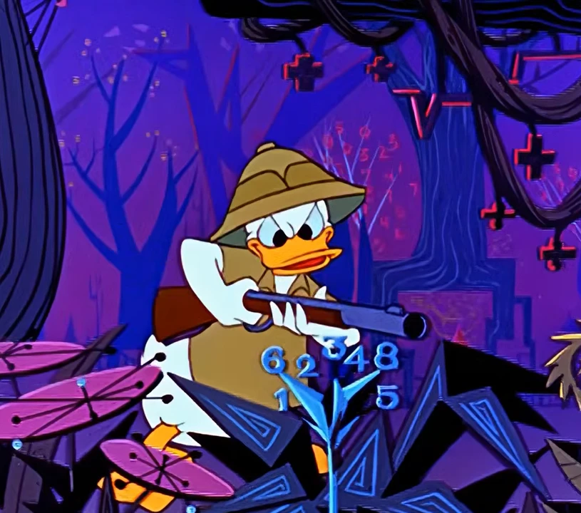

PhD candidate at Paris 13 supervised by
[Morgan Rogers](https://lipn.univ-paris13.fr/~rogers/) and
[Grégory Ginot](https://www.math.univ-paris13.fr/~ginot/).
Lately, I've been thinking about 1-, 2-, $\infty$-, multi-, generalized multi-, ... categories.

**Email:** [czech@math.univ-paris13.fr](mailto:czech@math.univ-paris13.fr)

### Upcoming

- **26–27 Nov 2026** · [Higher Geometric Structures along the Lower Rhine XXI](https://www.mpim-bonn.mpg.de/node/15870), MPIM Bonn

